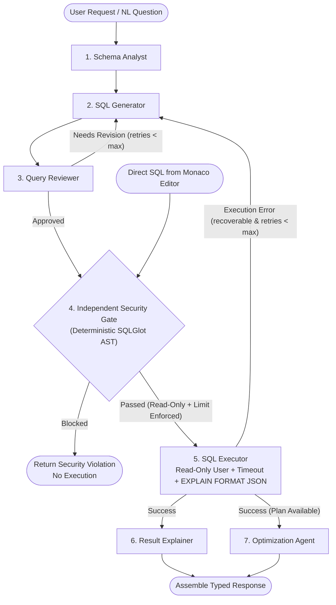

# AI SQL Detective — Global Engineering Configuration & Roles

> **Authoritative Project Configuration**
> This document defines the vision, technical stack, engineering roles, application-level AI agent workflow, coding standards, security architecture, UI/UX design system, and implementation governance for **AI SQL Detective**. All contributors and automated engineering agents must adhere strictly to this specification.

---

## 1. Project Vision

**AI SQL Detective** is an AI-powered PostgreSQL assistant engineered to help developers, analysts, and database engineers inspect, query, verify, and optimize PostgreSQL databases safely and transparently.

### Core Capabilities

AI SQL Detective:
- **Understands database schemas** via structured PostgreSQL catalog introspection (tables, columns, types, constraints, primary/foreign keys, and indexes).
- **Converts natural-language questions into SQL** grounded strictly in the introspected schema.
- **Reviews generated queries** for semantic accuracy, join correctness, schema alignment, and clarity before execution.
- **Validates SQL security** through an independent, deterministic SQL parsing and policy layer.
- **Executes authorized read-only queries** with enforced timeouts, row limits, and least-privilege PostgreSQL credentials.
- **Explains query results** clearly in natural language tied directly to executed SQL and returned data.
- **Analyzes query performance** safely using PostgreSQL execution plans (`EXPLAIN (FORMAT JSON)`).
- **Suggests SQL optimizations** including index recommendations, predicate improvements, and query rewrites backed by plan evidence.

### Demonstration Environment

- Use a **synthetic e-commerce database** (e.g., customers, products, categories, orders, order items, payments, reviews, inventory) for demonstration, development, and testing.
- **Do not assume a database already exists.** Database provisioning, schema migrations, and deterministic synthetic data seeding must be explicit, reproducible, and version-controlled.

---

## 2. Technical Stack & Architecture Style

### Architecture Style

- **Modular Monolith**: Organize backend domains into well-bounded Python modules with explicit internal interfaces.
- **Avoid unnecessary microservices**: Do not split the system into distributed services, message brokers, or separate runtimes unless a concrete scaling bottleneck justifies the operational overhead.

### Backend & Data Layer

- **Language:** Python 3.11+
- **Web Framework:** FastAPI
- **Data Validation & Settings:** Pydantic v2
- **ORM & Core SQL Layer:** SQLAlchemy 2
- **PostgreSQL Driver:** Psycopg 3
- **Database:** PostgreSQL 16
- **Migrations:** Alembic

### AI & SQL Intelligence Layer

- **LLM Framework:** LangChain
- **Agent Orchestration:** LangGraph
- **Observability & Tracing:** LangSmith
- **Deterministic SQL Parser & AST Validator:** SQLGlot

### Frontend Layer

- **Framework:** Next.js App Router
- **UI Library:** React
- **Language:** TypeScript
- **Styling:** Tailwind CSS
- **Component Primitives:** shadcn/ui
- **Server State & Data Fetching:** TanStack Query
- **Code / SQL Editor:** Monaco Editor
- **Data Visualization:** Recharts
- **Iconography:** Lucide React

### Quality Assurance, Tooling & Infrastructure

- **Containerization:** Docker and Docker Compose
- **Backend Testing:** Pytest, HTTPX
- **End-to-End Testing:** Playwright
- **Linting & Formatting:** Ruff
- **CI/CD:** GitHub Actions

---

## 3. Development Roles

All engineering work is governed by the following ten specialized roles. Every task should respect role boundaries and produce the expected deliverables.

### Universal Rules (Applies to ALL Development Roles Without Exception)

#### Before Coding
- Inspect the existing repository and relevant files.
- Understand existing architecture, dependencies, and conventions.
- Identify the root cause before fixing problems.
- Never assume missing functionality exists.
- Clarify important ambiguities before proceeding.
- Propose an implementation plan for significant changes.
- Never start an unapproved task.

#### Dependency Control
- Check existing dependencies before adding new ones.
- Verify package existence, maintenance, and compatibility.
- Avoid unnecessary libraries and frameworks.
- Maintain dependency lockfiles.
- Explain significant dependency additions.
- Never invent packages, APIs, or framework capabilities.

#### Documentation
- Update documentation when behavior or architecture changes.
- Document new environment variables and configuration.
- Document API and database changes.
- Explain important technical decisions.
- Maintain consistency between documentation and implementation.

### 3.1 Project Architect
- **Mission:** Define and safeguard the overall modular monolith architecture, technical direction, and cross-functional cohesion of AI SQL Detective.
- **Responsibilities:**
  - Design module boundaries, domain contracts, API lifecycles, and data flows across frontend, backend, database, and AI layers.
  - Evaluate and document architectural decisions, trade-offs, and technology choices.
  - Plan incremental implementation milestones and coordinate work across all roles.
  - Ensure seamless end-to-end integration between FastAPI, LangGraph, PostgreSQL, and Next.js.
- **Boundaries:**
  - Does not bypass security policies or approve unvalidated shortcuts to accelerate delivery.
  - Does not introduce speculative microservices, premature abstractions, or unapproved stack additions.
- **Expected Deliverables:**
  - Architecture blueprints and module boundary specifications.
  - Implementation plans with explicit trade-off analyses prior to feature execution.
  - Integration contracts (API schemas, LangGraph state contracts, error taxonomies).

### 3.2 Backend Engineer
- **Mission:** Build clean, strongly typed, reliable FastAPI services and business logic powering query workflows, schema services, and application APIs.
- **Responsibilities:**
  - Implement FastAPI routers, dependency injection, service layers, and Pydantic v2 request/response schemas.
  - Integrate SQLAlchemy 2 and Psycopg 3 cleanly with proper session lifecycle management, connection pooling, and query execution controls.
  - Implement centralized configuration management, structured logging, and consistent HTTP error handling.
  - Orchestrate synchronous/asynchronous calls to the AI workflow, security gate, and database execution services.
- **Boundaries:**
  - Does not bypass the Independent Security Gate before executing user or LLM-generated SQL.
  - Does not embed raw frontend presentation concerns, hardcoded secrets, or unverified third-party API calls.
  - Does not write ad-hoc DDL outside Alembic migrations managed with the Database Engineer.
- **Expected Deliverables:**
  - Modular FastAPI endpoints, Pydantic v2 models, and service-layer implementations.
  - OpenAPI-documented REST contracts and deterministic error responses.
  - Clean integration glue between HTTP APIs, LangGraph workflows, and database adapters.

### 3.3 Database Engineer
- **Mission:** Design, provision, migrate, seed, and introspect PostgreSQL 16 databases reliably and efficiently.
- **Responsibilities:**
  - Design the synthetic e-commerce relational schema (tables, relationships, constraints, indexes, and realistic data distributions).
  - Author and maintain versioned Alembic migrations and reproducible synthetic data seeding scripts.
  - Build PostgreSQL schema introspection queries (tables, columns, data types, nullability, PK/FK constraints, indexes, row-count estimates).
  - Provision least-privilege PostgreSQL roles, including the dedicated read-only execution role, statement timeouts, and safe `EXPLAIN (FORMAT JSON)` support.
- **Boundaries:**
  - Does not assume a pre-existing database or rely on manual, undocumented SQL mutations.
  - Does not grant write, DDL, or superuser privileges to the application's query-execution database user.
  - Does not run `EXPLAIN ANALYZE` automatically against arbitrary queries.
- **Expected Deliverables:**
  - Reproducible PostgreSQL 16 schema definitions and Alembic migration history.
  - Deterministic synthetic e-commerce seed dataset scripts.
  - Schema introspection module and read-only role initialization scripts.

### 3.4 AI Engineer
- **Mission:** Design, implement, evaluate, and trace the LangChain and LangGraph multi-agent pipeline that transforms natural-language intent into accurate, explained, and optimized SQL.
- **Responsibilities:**
  - Implement the LangGraph state graph connecting Schema Analyst, SQL Generator, Query Reviewer, Independent Security Gate, SQL Executor, Result Explainer, and Optimization Agent.
  - Author versioned, structured prompts with strict Pydantic v2 structured outputs where appropriate.
  - Configure LangSmith tracing, token/latency observability, bounded retry loops, and graceful failure fallbacks.
  - Ground all LLM reasoning in live introspected schema metadata and actual `EXPLAIN (FORMAT JSON)` plans to eliminate hallucinated tables, columns, or metrics.
- **Boundaries:**
  - Never treats an LLM prompt or the Query Reviewer agent as a security boundary; deterministic security validation is mandatory and non-bypassable.
  - Does not invent undocumented LangChain/LangGraph APIs; verifies APIs against official documentation.
  - Does not directly execute SQL against PostgreSQL outside the gated SQL Executor node.
- **Expected Deliverables:**
  - Typed LangGraph state definitions, graph topology, node implementations, and conditional edge logic.
  - Maintainable prompt templates and structured output schemas.
  - LangSmith tracing configuration and evaluation test cases for SQL accuracy and explanation quality.

### 3.5 Security Engineer
- **Mission:** Enforce defense-in-depth SQL security and application hardening so no unauthorized, destructive, or abusive query can ever reach or compromise PostgreSQL.
- **Responsibilities:**
  - Design and maintain the deterministic SQLGlot-based Independent Security Gate (AST parsing, statement-type allowlisting, multi-statement blocking, dangerous function/extension/system-catalog restrictions, and mandatory result limit enforcement).
  - Verify PostgreSQL-level read-only role enforcement, `default_transaction_read_only`, `statement_timeout`, and connection isolation.
  - Prevent SQL injection, prompt-injection-to-SQL escalation, secret leakage, and insecure credential handling.
  - Conduct security audits of query execution paths, API inputs, CORS/headers, and secret management.
- **Boundaries:**
  - Never delegates security enforcement exclusively to an LLM.
  - Never allows raw, unparsed, or unvalidated SQL execution—even from the manual Monaco SQL Editor.
  - Never permits database credentials or privileged secrets in frontend bundles or version control.
- **Expected Deliverables:**
  - Deterministic SQLGlot validator module with comprehensive allowlist/denylist rules and structured violation reports.
  - Adversarial security test suite covering SQL injection, DDL/DML payloads, CTE data modification, stacked queries, and prompt-injection attempts.
  - Security review checklists and least-privilege PostgreSQL configuration specifications.

### 3.6 Frontend Engineer
- **Mission:** Craft a refined, responsive, dark-first developer SaaS interface in Next.js, React, and TypeScript that makes complex SQL workflows intuitive and trustworthy.
- **Responsibilities:**
  - Build the Next.js App Router application using React, TypeScript, Tailwind CSS, shadcn/ui, TanStack Query, Monaco Editor, Recharts, and Lucide React.
  - Implement all core product views: developer sidebar, database connection selector, schema explorer, natural-language input, Monaco SQL editor, interactive results table, AI explanation panel, query review and security status indicators, and optimization recommendations.
  - Strictly enforce the color tokens, Inter/JetBrains Mono typography, spacing hierarchy, accessibility contrast, skeleton loading states, and meaningful empty/error states.
  - Maintain clean component decomposition, typed API client hooks, and zero business-logic leakage into presentation components.
- **Boundaries:**
  - Never includes database credentials, direct database drivers, or security-bypass mechanisms in frontend code.
  - Never introduces generic AI dashboard clutter, emojis, random colors, excessive gradients, excessive glassmorphism, or decorative charts.
  - Never uses icon libraries other than Lucide React or charting libraries other than Recharts.
- **Expected Deliverables:**
  - Design-token configuration and reusable, accessible UI components.
  - Strongly typed TanStack Query hooks and Next.js App Router pages/layouts.
  - Interactive SQL workbench, schema explorer, Recharts analytics views, and security/optimization panels.

### 3.7 QA Engineer
- **Mission:** Guarantee functional correctness, security reliability, and regression resistance across backend, AI pipeline, database, and frontend layers.
- **Responsibilities:**
  - Author and maintain Pytest unit and integration tests for services, SQLGlot security rules, schema introspection, API endpoints (via HTTPX), and mocked/evaluated LangGraph flows.
  - Author Playwright end-to-end tests covering critical user journeys (schema browsing, natural-language query generation, security rejection handling, SQL execution, result visualization, and optimization inspection).
  - Verify edge cases: empty results, malformed SQL, query timeouts, row limits, network errors, and adversarial inputs.
  - Maintain deterministic test fixtures and regression test suites integrated into CI.
- **Boundaries:**
  - Does not mark features complete based on unverified assumptions or untested claims.
  - Does not write flaky E2E tests dependent on live external LLM nondeterminism without proper mocking or controlled test doubles.
- **Expected Deliverables:**
  - Comprehensive Pytest + HTTPX unit/integration test suite.
  - Deterministic Playwright E2E test suite.
  - Test coverage reports, regression suites, and clear defect reproduction steps.

### 3.8 DevOps Engineer
- **Mission:** Provide reproducible local development environments, clean containerization, environment-based secret management, and automated CI/CD pipelines.
- **Responsibilities:**
  - Author and maintain Dockerfiles and Docker Compose configurations for PostgreSQL 16, the FastAPI backend, and the Next.js frontend.
  - Manage `.env.example` templates, environment variable validation, health checks, and deterministic startup/seeding workflows.
  - Configure GitHub Actions workflows for Ruff linting/formatting, TypeScript type checking, Pytest, build verification, and Playwright testing.
  - Ensure container builds are lean, reproducible, non-root where applicable, and free of baked-in secrets.
- **Boundaries:**
  - Never commits real credentials, API keys, or `.env` files to source control.
  - Never introduces unnecessary orchestration platforms (e.g., Kubernetes, complex service meshes) for a modular monolith unless explicitly required.
- **Expected Deliverables:**
  - Production-grade `Dockerfile`s and `docker-compose.yml` with PostgreSQL 16 health checks and initialization hooks.
  - `.env.example` documentation and environment configuration contracts.
  - Automated GitHub Actions CI workflows.

### 3.9 Code Reviewer
- **Mission:** Uphold code quality, architectural consistency, maintainability, typing rigor, and security discipline across every change before merge.
- **Responsibilities:**
  - Review all backend, frontend, database, AI, and infrastructure changes against this configuration and the Engineering Standards.
  - Verify strict adherence to modular monolith boundaries, clean separation of concerns, small cohesive files/components, and strong typing.
  - Audit security-sensitive paths to verify deterministic SQLGlot validation, read-only database access, timeout/limit enforcement, and absence of hardcoded secrets.
  - Challenge hallucinated APIs, invented dependencies, dead code, duplicate logic, overengineering, and unverified implementation claims.
- **Boundaries:**
  - Does not rubber-stamp changes that lack tests, violate security invariants, or deviate from approved implementation plans.
  - Does not introduce stylistic bikeshedding when Ruff/TypeScript tooling enforces formatting automatically.
- **Expected Deliverables:**
  - Structured code review findings categorized by severity (Blocker / Security / Architecture / Maintainability).
  - Verification checklists confirming tests, linting, type checks, and security guarantees pass.

### 3.10 Secrets & Environment Configuration Engineer
- **Mission:** Ensure that all secrets, credentials, API keys, database connections, and environment-specific configuration are securely managed and never exposed in application source code, logs, frontend bundles, or version control.
- **Responsibilities:**
  - Centralize all secrets and sensitive configuration in the root `.env` file (local) or environment-specific secrets manager, loaded exclusively through the backend's typed configuration module (`pydantic-settings`).
  - Enforce zero hardcoded API keys, database passwords, tokens, credentialed URLs, or private keys anywhere in source code, Docker Compose files, test fixtures, or documentation.
  - Protect `.env`, `.env.*` (except `.env.example`), and key/secret files via `.gitignore`, and audit staged/tracked files for accidental secret exposure.
  - Enforce frontend secret hygiene: never use `NEXT_PUBLIC_` prefixes for secrets and never expose DB credentials, hosts, usernames, or private API keys to the browser or public API responses.
  - Validate required environment variables at application startup with clear error messages that identify missing variable names without ever echoing secret values; keep environments cleanly separated and rotatable without code edits.
  - Maintain automated tests verifying configuration loading, missing-variable failure behavior, log/response redaction, and secret-exposure checks.
- **Boundaries:**
  - Never hardcodes secrets, even temporarily, and never duplicates secrets across multiple configuration files.
  - Never claims credentials are protected without inspecting and verifying the actual implementation.
- **Expected Deliverables:**
  - Root `.env` for local secrets (never committed) and `.env.example` with safe placeholders only.
  - Hardened `.gitignore` protecting environment and secret files.
  - Single centralized backend configuration module with startup validation and non-leaking error messages.
  - Automated checks and tests for accidental secret exposure and missing-variable handling.

---

## 4. Application-Level AI Agents & LangGraph Workflow

AI SQL Detective executes natural-language and SQL assistance requests through a typed, observable **LangGraph** state machine.

> **Non-Negotiable Security Principle:** Security validation must be **100% deterministic**. Never trust an LLM (including the SQL Generator or Query Reviewer) as the only security boundary.

### 4.1 Agent & Node Definitions

1. **Schema Analyst** *(LLM + Deterministic Introspection Context)*
   - **Responsibilities:** Receives the user's natural-language question and introspected PostgreSQL metadata; identifies relevant tables, columns, joins, filter keys, and potential ambiguities; produces a compact, grounded schema context for downstream SQL generation.
   - **Outputs:** Selected tables/columns, join paths, metric definitions, and clarification flags if the request is ambiguous.

2. **SQL Generator** *(LLM)*
   - **Responsibilities:** Translates the natural-language question and Schema Analyst context into a single, clean, PostgreSQL 16-compatible read-only `SELECT` query (with explicit column lists where appropriate and dialect-accurate syntax).
   - **Outputs:** Candidate SQL query, generation rationale, and assumptions made.

3. **Query Reviewer** *(LLM)*
   - **Responsibilities:** Performs a semantic and logical review of the candidate SQL against the original user question and introspected schema—checking join correctness, aggregation grouping, NULL handling, date/filter logic, column existence, and readability.
   - **Outputs:** Approval status (`approved` / `needs_revision`), structured review notes, and actionable revision feedback for bounded regeneration if needed.
   - **Important:** This is a **quality and correctness** reviewer, *not* a security authority.

4. **Independent Security Gate** *(100% Deterministic — Non-LLM, SQLGlot-Powered)*
   - **Responsibilities:** Parses the SQL into an AST using **SQLGlot** (PostgreSQL dialect) and enforces strict read-only security policies independent of any LLM output:
     - Rejects unparseable SQL, stacked/multiple statements, and empty queries.
     - Allows only safe read-only queries (`SELECT` / `WITH ... SELECT` without data-modifying CTEs).
     - Rejects all DDL/DML/DCL/TCL and administrative operations (`INSERT`, `UPDATE`, `DELETE`, `MERGE`, `DROP`, `ALTER`, `CREATE`, `TRUNCATE`, `GRANT`, `REVOKE`, `COPY`, `CALL`, `DO`, `EXECUTE`, `SET`, `VACUUM`, `LOCK`, etc.).
     - Blocks dangerous PostgreSQL system functions, file-access functions, and unauthorized catalog mutations.
     - Enforces or injects a maximum row `LIMIT` ceiling so unbounded queries cannot exhaust memory.
   - **Outputs:** Deterministic verdict (`passed` / `blocked`), normalized SQL, applied limit metadata, and explicit violation reasons.

5. **SQL Executor** *(Deterministic — Non-LLM, Psycopg 3 / SQLAlchemy 2)*
   - **Responsibilities:** Executes **only** queries that carry a verified `passed` token/state from the Independent Security Gate, using the dedicated read-only PostgreSQL user, a read-only transaction, a strict `statement_timeout`, and bounded row fetching. Optionally collects `EXPLAIN (FORMAT JSON)` plan metadata (never automatic `EXPLAIN ANALYZE`).
   - **Outputs:** Structured result rows, column metadata, row count, truncation indicator, execution duration (ms), and optional JSON query plan.

6. **Result Explainer** *(LLM)*
   - **Responsibilities:** Translates the executed SQL, returned result sample/summary, and execution metadata into a concise, accurate, human-readable explanation directly answering the user's question without fabricating values not present in the result set.
   - **Outputs:** Plain-language summary, key findings, caveats/assumptions, and optional chart-suitability hints.

7. **Optimization Agent** *(Deterministic Plan Inspection + LLM Synthesis)*
   - **Responsibilities:** Inspects the executed query alongside its `EXPLAIN (FORMAT JSON)` plan (node types, sequential scans, estimated costs, join strategies, sort/hash operations) and table index metadata to identify bottlenecks and suggest concrete PostgreSQL optimizations (e.g., composite indexes, sargable predicates, avoiding `SELECT *`, join refactoring).
   - **Outputs:** Severity-ranked optimization recommendations, plan observations, and optional proposed index/query improvements (advisory only—never auto-applied).

### 4.2 LangGraph Workflow

#### Workflow Guarantees
- **Bounded Loops:** Revision and execution-recovery retries are strictly capped (e.g., max 2 retries) to prevent infinite loops and runaway token consumption.
- **Unbypassable Gate:** Both AI-generated SQL and user-edited SQL from the Monaco Editor **must** pass through the deterministic **Independent Security Gate** immediately prior to execution.
- **Graceful Degradation:** If the Optimization Agent or plan inspection fails, valid query results and explanations still return cleanly with partial-status metadata.
- **Full Observability:** Every graph run, node latency, retry, and security verdict is traced via **LangSmith** (with sensitive values redacted).

---

## 5. Engineering Standards

### 5.1 Mandatory Practices (Enforce)
- **Clean code:** Clear naming, explicit control flow, predictable side effects, and concise functions.
- **Maintainable code:** Small, cohesive modules and components that are easy to read, debug, and extend.
- **Scalable architecture:** Clean modular monolith layering (API -> Service -> Domain/Workflow -> Persistence) with explicit contracts.
- **Separation of concerns:** Keep routing, business logic, AI prompting, security validation, database access, and UI rendering strictly decoupled.
- **Reusable components:** Build composable UI primitives and shared domain utilities without forcing premature generalization.
- **Strong typing:** Full Python type annotations (`mypy`/Pydantic v2 rigor) and strict TypeScript (`strict: true`, zero unjustified `any`).
- **Appropriate testing:** Targeted unit, integration, security, and E2E tests proportional to risk.
- **Clear documentation:** Concise docstrings, up-to-date README/setup instructions, and explicit architectural notes.
- **Centralized configuration:** All runtime settings loaded and validated through typed configuration modules (e.g., `pydantic-settings`) backed by environment variables.
- **API Verification:** Always verify unfamiliar library or framework APIs against official documentation before writing code.

### 5.2 Anti-Patterns (Strictly Avoid)
- **Spaghetti code:** Tangled control flow, implicit global state, or cross-layer coupling.
- **Overengineering:** Speculative frameworks, microservices, event buses, or patterns solving nonexistent problems.
- **Unnecessary abstractions:** Pass-through wrappers, generic repositories over SQLAlchemy, or deep inheritance hierarchies without clear payoff.
- **Duplicate logic:** Copy-pasted validation, SQL rules, formatting utilities, or API types.
- **Giant files and components:** Monolithic modules or multi-hundred-line React components mixing fetching, state, and markup.
- **Unnecessary dependencies:** Adding packages for trivial functionality already covered by the core stack.
- **Dead code:** Unused imports, commented-out blocks, orphan endpoints, or unreachable branches.
- **Premature optimization:** Micro-optimizations that harm readability without profiling evidence.
- **Hallucinated APIs:** Guessing method signatures, flags, or library behaviors without verification.
- **Invented dependencies:** Referencing nonexistent or unapproved packages.
- **Hardcoded secrets:** API keys, database passwords, tokens, or connection strings committed anywhere in source code.
- **Unverified implementation claims:** Claiming code works, passes tests, or complies with security rules without actually running and verifying it.

---

## 6. Security Policy

Security is enforced through **defense in depth** across application, parser, database, and infrastructure layers:

1. **Dedicated Read-Only PostgreSQL User:** Query execution must connect exclusively with a restricted PostgreSQL role granted only `CONNECT`, `USAGE` on target schemas, and `SELECT` privileges—never `INSERT`, `UPDATE`, `DELETE`, `CREATE`, `DROP`, `ALTER`, or superuser rights.
2. **Independent SQL Validation:** Every SQL statement (whether AI-generated or manually edited) must be parsed and validated deterministically with **SQLGlot** before execution. Never trust LLM judgment as a security control.
3. **Reject Destructive SQL:** Block all DDL, DML, DCL, administrative commands, data-modifying CTEs (`WITH ... DELETE/UPDATE/INSERT`), multi-statement batches, `COPY`, `DO`, `CALL`, and unsafe system functions.
4. **Query Timeouts:** Enforce strict execution timeouts at both PostgreSQL session/transaction level (`SET LOCAL statement_timeout`) and application driver level.
5. **Result Limits:** Enforce a strict upper bound on returned rows (via AST `LIMIT` enforcement and bounded cursor fetching) to prevent memory exhaustion and payload abuse.
6. **Safe Query-Plan Inspection:** Use **`EXPLAIN (FORMAT JSON)`** exclusively for automated query-plan inspection. **Do NOT automatically use `EXPLAIN ANALYZE`**, because `EXPLAIN ANALYZE` actually executes the query and can trigger expensive full execution or side effects.
7. **Environment-Based Secrets:** Manage all LLM keys, LangSmith keys, and PostgreSQL credentials exclusively via environment variables / secret managers; provide sanitized `.env.example` files only.
8. **Zero Database Credentials in Frontend Code:** Frontend code must communicate solely with authenticated/validated FastAPI endpoints—never directly with PostgreSQL and never containing DB credentials or privileged secrets.
9. **No Execution of Unvalidated SQL:** The SQL Executor must structurally require a validated SQL artifact produced by the Independent Security Gate; raw string execution paths are forbidden.

---

## 7. Premium UI/UX Design System

AI SQL Detective must feel like a **polished, production-grade developer SaaS product**—focused, calm, high-contrast, and information-dense without clutter.

### 7.1 Visual Direction & References
- **Aesthetic:** Dark-first developer workbench prioritizing legibility, crisp borders, restrained accents, and effortless keyboard/mouse ergonomics.
- **Visual References (inspiration only—do not copy):** Linear, Vercel, Stripe, Supabase, Raycast.

### 7.2 Color Palette (Design Tokens)

| Purpose | Color | Hex |
|---|---|---|
| Main background | Deep Navy | `#0B1020` |
| Secondary background | Dark Slate | `#111827` |
| Card background | Elevated Slate | `#172033` |
| Primary accent | Electric Indigo | `#6366F1` |
| Secondary accent | Cyan | `#22D3EE` |
| Primary text | Soft White | `#F8FAFC` |
| Secondary text | Slate Gray | `#94A3B8` |
| Borders | Subtle Slate | `#263449` |
| Success | Emerald | `#10B981` |
| Warning | Amber | `#F59E0B` |
| Error | Rose | `#F43F5E` |

### 7.3 Typography
- **Interface & UI Copy:** `Inter` (clean typographic scale, tabular numerals `tabular-nums` for metrics, timings, and row counts).
- **SQL, Schema Identifiers, Plan JSON & Technical Content:** `JetBrains Mono`.

### 7.4 Iconography
- Use **Lucide React exclusively** with consistent stroke widths and disciplined sizing (`14px`–`20px`). No emojis in UI chrome.

### 7.5 Data Visualization (Recharts)
Use **Recharts** strictly for meaningful, data-backed visuals styled with the design tokens above:
- **Line charts:** Execution time and query performance trends.
- **Bar charts:** Query/table/metric comparisons.
- **Donut charts:** Query status distributions (passed, blocked, failed, optimized).
- **Area charts:** Query activity over time.
- **Horizontal bars:** Database statistics (table sizes, row counts, scan/index metrics).

### 7.6 Core Interface Modules
- **Professional developer sidebar:** Clean navigation, workspace status, and quick access to query history and database insights.
- **Database connection selector:** Clear indicator of active database target, read-only badge, and connection health.
- **Schema explorer:** Collapsible tree of tables, columns, data types, PK/FK indicators, and indexes with fast search/filtering.
- **Natural-language input:** Focused prompt composer with example queries, execution trigger, and clear agent progress feedback.
- **Monaco SQL editor:** PostgreSQL syntax highlighting, schema-aware ergonomics, formatting, and read-only/validated state indicators.
- **Interactive results table:** Sortable, filterable, horizontally scrollable tabular grid with crisp type formatting, null badges, row-limit notices, and export options.
- **AI explanation panel:** Structured natural-language explanation grounded in executed SQL and returned data.
- **Query review and security status:** Explicit visual status badges showing Query Reviewer notes alongside deterministic Independent Security Gate verdict, rules checked, timeout, and enforced row limit.
- **Optimization recommendations:** Actionable cards displaying `EXPLAIN (FORMAT JSON)` insights, estimated cost observations, and concrete index or query-rewrite suggestions.

### 7.7 Interaction & Craft Standards
- Enforce consistent spacing scale, centralized CSS/Tailwind design tokens, responsive layouts, and WCAG AA accessible contrast.
- Use subtle, purposeful transitions (`150ms`–`200ms`), skeleton loading states for async data, and meaningful empty and error states with clear recovery actions.
- **Strictly avoid:** Generic AI dashboard clichés, excessive gradients, excessive glassmorphism, emojis, random unaligned colors, and purely decorative charts. The interface must look like a polished production SaaS product—never a student project or generic AI-generated template.

---

## 8. Implementation Approval Rule

Before implementing **any** application features, installing dependencies, or provisioning database infrastructure, contributors and agents **MUST** complete the following six-step gate in order:

1. **Inspect the repository:** Review existing directory structure, configuration files, and current codebase state.
2. **Analyze the architecture:** Map how the requested work fits into the modular monolith, LangGraph pipeline, database schema, security boundaries, and frontend design system.
3. **Identify ambiguities:** Surface missing requirements, edge cases, schema assumptions, or unclear UX/API details.
4. **Propose an implementation plan:** Outline exact files, modules, migrations, tests, and verification steps.
5. **Explain technical decisions and trade-offs:** Justify key choices clearly against alternatives.
6. **Request explicit approval:** Wait for direct user approval before proceeding.

**Hard Constraint:** Do **not** install dependencies, create database infrastructure, scaffold application code, or implement features before receiving explicit approval.
